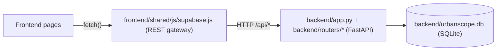
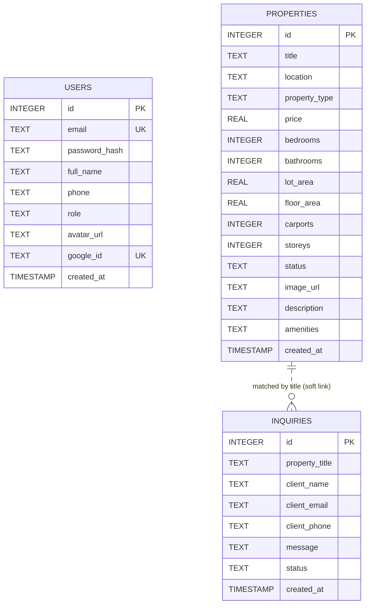
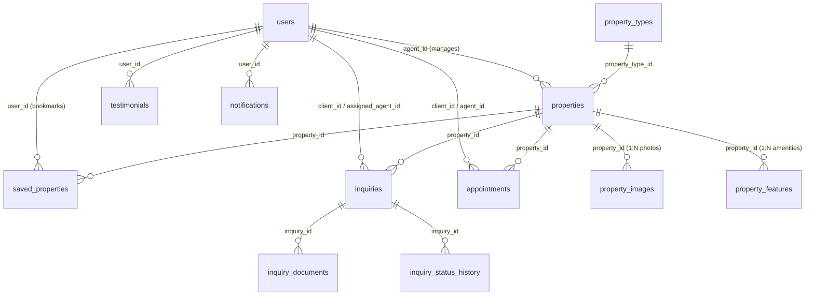

# Database — UrbanScope (Miriam Lobren Real Estate)

This document describes the data layer behind the UrbanScope platform: the
schema, seed data, how migrations work, and how the frontend reaches it.

> Source of truth: [`backend/database.py`](backend/database.py).
> If this document and the code disagree, the code wins — please update this file.

---

## 1. Overview

| Item | Value |
| :--- | :--- |
| Engine (runtime) | **SQLite 3** via Python's standard `sqlite3` module |
| File | `backend/urbanscope.db` (auto-created, **git-ignored** via `*.db`) |
| Access layer | Raw parameterised SQL in [`backend/routers/`](backend/routers) — no ORM |
| Connection helper | `get_db_connection()` — `row_factory = sqlite3.Row`, `check_same_thread=False` |
| Schema bootstrap | `init_db()` — runs on import of `backend.app` **and** in the FastAPI lifespan hook |
| Optional cloud mirror | [`supabase/migrations/`](supabase/migrations) + [`supabase/seed.sql`](supabase/seed.sql) (Supabase CLI), or the one-shot [`backend/supabase_schema.sql`](backend/supabase_schema.sql) |



> [!NOTE]
> Despite its name, `frontend/shared/js/supabase.js` does **not** talk to Supabase. It is a
> REST client for the local FastAPI backend, kept under that filename for
> backward compatibility with existing page scripts.

---

## 2. Entity Relationship

There are **no foreign keys**. Inquiries reference properties by *title text*,
not by ID, and are not linked to user accounts.



---

## 3. Tables

### 3.1 `users`

Client and admin accounts.

| Column | Type | Constraints / Default | Notes |
| :--- | :--- | :--- | :--- |
| `id` | INTEGER | PK, AUTOINCREMENT | Used as JWT `sub` claim |
| `email` | TEXT | UNIQUE, NOT NULL | Stored lower-cased on register; lookups use `LOWER(email)` |
| `password_hash` | TEXT | NOT NULL | Format `"<salt_hex>$<pbkdf2_hex>"` — see §6 |
| `full_name` | TEXT | NOT NULL | |
| `phone` | TEXT | — | Free-form; frontend validates PH formats (`+639…` / `09…`) |
| `role` | TEXT | `CHECK(role IN ('user', 'admin', 'superadmin')) DEFAULT 'user'` | Initial role assigned on insert via trigger `trg_user_role_insert` (`urbanscope.cvsu@gmail.com` → `'superadmin'`, `miriamalobren@gmail.com` / `admin.realestate@gmail.com` → `'admin'`, others → `'user'`). Trigger `trg_user_role_update` preserves `OLD.role` on email changes. Superadmins modify roles via `PUT /api/superadmin/users/{id}`. |
| `avatar_url` | TEXT | `DEFAULT 'assets/images/agent.jpg'` | Profile picture image path, Google avatar URL, or data URL (max client upload size: 5MB) |
| `google_id` | TEXT | Partial `UNIQUE` (`idx_users_google_id`) | Google OpenID `sub` identifier linked on Google Sign-In (*added by non-destructive migration*) |
| `license_number` | TEXT | `DEFAULT ''` | Professional real estate broker / agent PRC registration identifier |
| `title` | TEXT | `DEFAULT 'Real Estate Agent'` | Professional title or organizational role |
| `brokerage` | TEXT | `DEFAULT 'UrbanScope'` | Accredited brokerage or realty firm |
| `bio` | TEXT | `DEFAULT ''` | Professional biography and summary |
| `email_verified_at` | TIMESTAMPTZ / TIMESTAMP | SQLite defaults to current time; Supabase is nullable | Set after email-code verification; existing Supabase accounts are backfilled as verified by migration `20261105120000_email_otp_auth.sql`. |
| `created_at` | TIMESTAMP | `CURRENT_TIMESTAMP` | UTC, `YYYY-MM-DD HH:MM:SS` |

### 3.1.1 Authentication challenge storage

SQLite `auth_email_challenges` stores one active challenge per normalized email and purpose (`register` or `password_reset`), with its HMAC digest, expiry, attempt count, and issue time. `auth_email_challenge_requests` stores keyed IP hashes and issue times to enforce the send limit. Neither table stores the plain code or raw requester IP. `trg_users_email_verified_default` marks trusted local account inserts as verified when no timestamp was supplied; pending registrations are held only in the challenge tables and are not inserted as users.

### 3.2 `properties`

Listing catalog shown on the home page, property detail pages, and admin pages.

| Column | Type | Default | Notes |
| :--- | :--- | :--- | :--- |
| `id` | INTEGER | PK, AUTOINCREMENT | Used in `property-detail.html?id=…` |
| `title` | TEXT | NOT NULL | Also the join key used by `inquiries.property_title` |
| `location` | TEXT | NOT NULL | e.g. `"Manuyo, Las Piñas City"` (may contain diacritics) |
| `property_type` | TEXT | NOT NULL | Free text — see type values below |
| `price` | REAL | NOT NULL | Philippine Pesos (₱), whole amount |
| `bedrooms` | INTEGER | `3` | |
| `bathrooms` | INTEGER | `2` | |
| `lot_area` | REAL | `120` | m² |
| `floor_area` | REAL | `80` | m² — *added by migration* |
| `carports` | INTEGER | `1` | *added by migration* |
| `storeys` | INTEGER | `2` | *added by migration* |
| `status` | TEXT | `'Available'` | Free text; `Sold` / `Sold Out` listings remain visible to clients but are excluded from property inquiry choices and rejected by inquiry submission checks. |
| `image_url` | TEXT | — | **Root-relative** path, e.g. `assets/images/property1.jpg` (relative to `frontend/`) |
| `description` | TEXT | — | |
| `amenities` | TEXT | `''` | **Comma-separated** list — *added by migration* |
| `created_at` | TIMESTAMP | `CURRENT_TIMESTAMP` | Catalog sorts `ORDER BY created_at DESC` |

**`property_type` values in use:** `Subdivision`, `Villa`, `Condominium`,
`Townhouse`, `Triplex`. The API also understands `Single Attached`.
The `GET /api/properties?type=` filter maps UI category aliases to these values:

| UI `type` param | Matches `property_type` containing… |
| :--- | :--- |
| `villa`, `villas` | `villa` |
| `townhouse(s)` | `townhouse` |
| `apartment(s)`, `condo`, `condominium(s)` | `condominium` **or** `apartment` |
| `subdivision(s)` | `subdivision` |
| `triplex(es)` | `triplex` |
| `single attached` | `single attached` |
| `luxury`, `luxury villas` | `villa` **or** `price >= 5,000,000` |
| `house-lot`, `house & lot`, `house(s)` | townhouse / subdivision / single attached / triplex / villa |
| anything else | `LIKE %value%` |

### 3.3 `inquiries`

Client consultation / viewing requests submitted from `frontend/pages/inquiry/inquiry.html`.

| Column | Type | Default | Notes |
| :--- | :--- | :--- | :--- |
| `id` | INTEGER | PK, AUTOINCREMENT | |
| `property_title` | TEXT | — | API substitutes `"General Inquiry"` when empty |
| `client_name` | TEXT | NOT NULL | Min length 2 (Pydantic) |
| `client_email` | TEXT | NOT NULL | Not linked to `users.email` |
| `client_phone` | TEXT | — | |
| `message` | TEXT | NOT NULL | |
| `status` | TEXT | `'Under Review'` | See lifecycle below |
| `created_at` | TIMESTAMP | `CURRENT_TIMESTAMP` | |
| `updated_at` | TIMESTAMP | `CURRENT_TIMESTAMP` | Updated on status or detail modifications (*added by migration*) |

**Status lifecycle (as used by the admin dashboard UI):**

```text
Submitted → Requirements Submitted → Under Review → Approved → Completed
```

`GET /api/stats` counts an inquiry as *pending* when `LOWER(status)` contains
`review` or `pending`.

---


### 3.4 `notifications`

Bi-directional inquiry lifecycle alerts for administrators (client cancellations/deletions) and clients (admin approvals).

| Column | Type | Default | Notes |
| :--- | :--- | :--- | :--- |
| `id` | INTEGER | PK, AUTOINCREMENT | |
| `recipient_role` | TEXT | `'admin'` | `'admin'` or `'client'` |
| `recipient_email` | TEXT | `''` | Lower-cased client email when `recipient_role = 'client'` |
| `type` | TEXT | `'info'` | `'cancelled'`, `'approved'`, `'new_inquiry'` |
| `inquiry_id` | INTEGER | — | Soft reference to `inquiries.id` |
| `property_title` | TEXT | `''` | Property or consultation topic |
| `client_name` | TEXT | `''` | Client full name |
| `title` | TEXT | NOT NULL | Notification headline |
| `message` | TEXT | NOT NULL | Notification body |
| `is_read` | INTEGER | `0` | `0` = unread, `1` = read |
| `is_seen` | INTEGER | `0` | `0` = unseen, `1` = seen/toasted (prevents repeat notifications across devices) |
| `created_at` | TIMESTAMP | `CURRENT_TIMESTAMP` | |

---

## 4. Search Normalisation

`get_db_connection()` registers a custom SQL function, `NORMALIZE(text)`, backed by
`normalize_text()` in Python. It:

1. Strips diacritics (`Las Piñas` → `las pinas`, `Dasmariñas` → `dasmarinas`)
2. Replaces `-` and `_` with spaces
3. Lower-cases and trims

All property filters compare `NORMALIZE(column) LIKE '%' || NORMALIZE(?) || '%'`,
so a user typing *"las pinas"* matches *"Las Piñas City"*.

> [!IMPORTANT]
> `NORMALIZE()` only exists on connections opened via `get_db_connection()`.
> Opening the DB with a plain `sqlite3.connect()` (or the `sqlite3` CLI) and running
> API queries will fail with `no such function: NORMALIZE`.

---

## 5. Migrations

There is no migration framework. `init_db()` is **idempotent** and non-destructive:

1. `CREATE TABLE IF NOT EXISTS` for the runtime tables.
2. For `properties`, reads `PRAGMA table_info(properties)` and runs
   `ALTER TABLE … ADD COLUMN` for any missing column
   (`floor_area`, `carports`, `storeys`, `amenities`).

**To add a new column:**

1. Add it to the `CREATE TABLE` statement in `init_db()` (for fresh databases).
2. Add a matching `if "<col>" not in existing_cols: ALTER TABLE …` guard (for existing databases).
3. Update the Pydantic models in [`backend/models.py`](backend/models.py)
   (`*Create`, `*Update`, `*Response`).
4. Update any explicit column lists in `INSERT` statements in [`backend/routers/`](backend/routers)
   and the seed block in `init_db()`.
5. Mirror the change in Supabase: add a **new** migration with `supabase migration new <name>`
   (never edit an already-applied file in `supabase/migrations/`), update
   [`supabase/seed.sql`](supabase/seed.sql) if seed rows need the column, and keep
   [`backend/supabase_schema.sql`](backend/supabase_schema.sql) in sync.
6. Update this document.

Migration `20261105120000_email_otp_auth.sql` adds the cloud email-verification timestamp, server-only challenge tables, and atomic issue/consume RPCs. Apply it before deploying the Vercel password registration and recovery endpoints.

> [!WARNING]
> SQLite cannot drop or rename columns safely with `ALTER TABLE` in older versions,
> and the guard pattern only handles *additions*. Renames/removals require a manual
> table rebuild — or, during development, simply deleting `backend/urbanscope.db`.

---

## 6. Passwords, Google OAuth & Tokens

Defined in [`backend/auth.py`](backend/auth.py).

- **Hashing:** PBKDF2-HMAC-SHA256, 100,000 iterations, 16-byte random hex salt.
  Stored as `salt$hash` (both hex). Verified with `hmac.compare_digest`. Accounts created
  purely via Google Sign-In receive a PBKDF2 hash of a 256-bit random token.
- **Password Updates (`PUT /api/admin/password` & `PUT /api/auth/password`):** Authenticated users
  and admins can update their password via `PasswordChangeRequest(current_password, new_password)`.
  The backend verifies `current_password` against SQLite `users.password_hash` before hashing and updating.
- **Client & Cloud PBKDF2 Interoperability (`supabase.js` & `api.js`):** Client-side scripts implement
  `verifyPBKDF2()` and `hashPBKDF2()` via native Web Crypto API (`crypto.subtle`), ensuring 100% cryptographic
  interoperability with Python PBKDF2 hashes across Supabase and Vercel hosting.
- **Google OAuth 2.0:** Verifies Google Identity Services `access_token` or `credential` (ID token)
  against `oauth2.googleapis.com/tokeninfo` and `www.googleapis.com/oauth2/v3/userinfo`, enforcing
  audience (`aud`/`azp`) match against `GOOGLE_CLIENT_ID` (from env or `.env`) and `email_verified == true`.
- **Email OTP:** Password registration and forgotten-password recovery use six-digit, single-use email codes. Challenges are stored as HMAC digests, expire after 10 minutes, allow five attempts, and have 60-second resend and 10-per-hour IP-hash limits. FastAPI stores challenge state in SQLite; Vercel uses the service-role-only Supabase issue/consume RPCs added by `20261105120000_email_otp_auth.sql`. Existing cloud users are marked verified by the migration. Password recovery also marks verified after successful email ownership proof. A database trigger prevents anonymous clients from assigning privileged roles, marking accounts verified, changing roles, or changing password hashes. Hosted Superadmin role/account edits and admin password changes use signed-session server functions; local cloud writes require the server-side service-role key.
- **Mail delivery configuration:** Set `RESEND_API_KEY`, a verified `RESEND_FROM_EMAIL`, and private `AUTH_OTP_SECRET` (at least 32 characters). Vercel also needs server-only `SUPABASE_SERVICE_ROLE_KEY`. Apply the migration before deploying Vercel OTP functions; never expose server secrets in frontend code.
- **JWT:** HS256, 7-day expiry, payload `{ sub: "<user id>", email, role, exp, iat }`.
  Secret from env var `URBANSCOPE_SECRET_KEY` (a hard-coded fallback exists for dev).
- **Vercel Admin Page Session:** Since Vercel serves the frontend statically, root Routing Middleware (`proxy.js`) verifies a separate 12-hour signed `HttpOnly`, `Secure`, `SameSite=Lax` cookie before returning Admin/Superadmin HTML. The Vercel Function at `POST /api/auth/edge-session` verifies Google directly and accepts the existing staff accounts plus optional comma-separated `VERCEL_ADMIN_EMAILS`; it does not trust the currently public Supabase user-table role/password policies. Configure the server-only `VERCEL_ADMIN_SESSION_SECRET` (minimum 32 characters) in Vercel Project Settings and redeploy. Admin staff can access Admin; only `urbanscope.cvsu@gmail.com` can access Superadmin. Hosted admin access uses Google Sign-In, while local FastAPI deployments keep password sign-in and the existing `access_token` cookie/middleware.
- **Client storage:** `localStorage` keys `urbanscope_jwt_token`, `urbanscope_user`,
  `urbanscope_demo_user`, `adminUser`, `adminPassword`, `urbanscope_admin_password_updated`.

---

## 7. Seed Data

Seeding happens inside `init_db()` **only when the table is empty**, per table.

**Users**

| Email | Password | Role | Name |
| :--- | :--- | :--- | :--- |
| `urbanscope.cvsu@gmail.com` | `urbanscope2026` | `superadmin` | UrbanScope Superadmin (CvSU) |
| `miriamalobren@gmail.com` | `111112` (or updated via Admin Profile) | `admin` | Miriam Lobren (Lead Admin) |
| `admin.realestate@gmail.com` | `realestate2026` | `admin` | Real Estate Admin |

**Properties (4 accredited featured listings)**

| Title | Location | Type | Price (₱) | Specs |
| :--- | :--- | :--- | ---: | :--- |
| Casasuerte | Barangay San Agustin, Trece Martires City, Cavite | Townhouse | 2,500,000 | 2 Beds, 1 Bath, 50.8 sqm |
| Kathleen | Molino 7, Bacoor, Cavite | Townhouse | 6,200,000 | 3 Beds, 2 Baths, 112.0 sqm |
| Liora Homes | Brgy. Malainen Bago, Naic, Cavite | Townhouse | 2,462,400 | 2 Beds, 1 Bath, 44.0 sqm |
| Airmen's Village Triplex | Pulang Lupa Dos, Las Piñas City | Triplex | 8,900,000 | 3 Beds, 3 Baths, 143.78 sqm |

**Inquiries (3)** — Sarah Jenkins (*Under Review*), Mark Anthony Cruz (*Approved*),
Maria Elena Santos (*Completed*).

> [!CAUTION]
> Seed credentials are for local development only. Change or remove them, and set
> `URBANSCOPE_SECRET_KEY`, before any public deployment.

---

## 8. Common Tasks

**Reset the database** (drops all data, re-seeds on next start):

```powershell
Remove-Item backend\urbanscope.db
python run.py
```

**Verify & re-seed RBAC accounts & triggers**:

```powershell
python backend/seed_rbac.py
```

**Run RBAC migration manually on existing database**:

```powershell
sqlite3 backend/urbanscope.db ".read backend/migration_rbac.sql"
```

**Inspect data** (read-only queries that don't use `NORMALIZE`):

```powershell
python -c "import sqlite3; c=sqlite3.connect('backend/urbanscope.db'); print(c.execute('SELECT id,title,price FROM properties').fetchall())"
```

**Run Database Integrity Checks:**

- From `/pages/superadmin/dashboard.html`, open **System Health** and select **Run Check**.
- Via API: `GET /api/superadmin/integrity` (Requires Superadmin Bearer token)
- Via Swagger UI: `http://127.0.0.1:8000/docs`

The superadmin console also provides account and role governance. Property listing and inquiry workflows belong to the Agent Admin portal.

---

## 9. Supabase / PostgreSQL Production Schema

[`backend/supabase_schema.sql`](backend/supabase_schema.sql) is the production-grade PostgreSQL / Supabase
schema. It is 3NF-normalized, enforces foreign key referential integrity, automated triggers, relational views,
performance indexes, and Row Level Security (RLS).

### 9.1 Normalized Relational Structure (12 Tables)



| Table | Purpose | Connected Foreign Keys |
| :--- | :--- | :--- |
| `users` | Accounts, clients, licensed agents, admins | Independent |
| `property_types` | Lookup: Subdivision, Villa, Condominium, Townhouse, Triplex, Single Attached | Independent |
| `properties` | Master catalog of real estate listings | `agent_id` -> `users.id`, `property_type_id` -> `property_types.id` |
| `property_images` | High-res carousel slides & thumbnails | `property_id` -> `properties.id` (CASCADE) |
| `property_features` | Normalized individual amenities | `property_id` -> `properties.id` (CASCADE) |
| `saved_properties` | Client bookmarks & heart favorites | `user_id` -> `users.id`, `property_id` -> `properties.id` (CASCADE) |
| `inquiries` | Client consultations & applications | `client_id` -> `users.id`, `property_id` -> `properties.id`, `assigned_agent_id` -> `users.id` |
| `inquiry_documents` | Verification IDs & proof of income | `inquiry_id` -> `inquiries.id` (CASCADE) |
| `inquiry_status_history` | Audit log of status transitions | `inquiry_id` -> `inquiries.id` (CASCADE), `changed_by` -> `users.id` |
| `appointments` | Scheduled property walkthroughs | `client_id` -> `users.id`, `agent_id` -> `users.id`, `property_id` -> `properties.id` |
| `testimonials` | Verified client reviews & ratings | `user_id` -> `users.id` |
| `notifications` | In-app alerts for users and agents | `user_id` -> `users.id` (CASCADE) |

### 9.2 Triggers & Views

- **`update_updated_at_column()`:** Automatically keeps `updated_at` current on row changes.
- **`sync_property_type_name()`:** Synchronizes `properties.property_type` string with `property_types.name` for backward compatibility with frontend queries.
- **`sync_property_primary_image()`:** Sets `properties.image_url` whenever a primary image is designated in `property_images`.
- **`handle_new_inquiry()`:** Auto-generates reference code (e.g. `INQ-2026-0001`) and writes initial audit record into `inquiry_status_history`.
- **Views:** `view_properties_catalog`, `view_inquiries_dashboard`, `view_dashboard_kpis`.

---

## 10. Migration & Supabase Setup Checklist

### 10.1 Supabase CLI migrations (recommended)

```text
supabase/
  config.toml                                Supabase CLI project config
  migrations/20261028000000_initial_schema.sql   Tables, triggers, indexes, views, RLS (no DROPs)
  migrations/20261030230000_admin_profile_fields_and_superadmin_role.sql
                                             users.title / brokerage / bio + 'superadmin' in users_role_check
  migrations/20261102010000_update_default_brokerage.sql
                                             Sets users.brokerage default to 'UrbanScope' and normalizes legacy rows
  migrations/20261102020000_expand_inquiry_status_workflow.sql
                                             Updates inquiries.status CHECK constraint to include all active CRM workflow statuses
  migrations/20261102030000_update_default_user_title.sql
                                             Sets default title to 'Real Estate Agent' and normalizes legacy rows
  migrations/20261102040000_inquiry_lifecycle_notifications.sql
                                             Extends notifications table for admin/client inquiry lifecycle alerts
  migrations/20261102050000_normalize_lead_admin_role_and_email.sql
                                             Normalizes lead agent account to miriam@gmail.com (role: admin), sets superadmin role for urbanscope.cvsu@gmail.com, demotes legacy duplicate id 1 to client, and re-points property agent_id
  migrations/20261103000000_notification_seen_sync.sql
                                             Adds is_seen column to notifications table for persistent cross-device seen and toast suppression sync
  migrations/20261103231500_allow_delete_users_rls.sql
                                             Adds "Allow delete users" RLS policy on users for Superadmin account deletion and purges soft-deleted rows
  migrations/20261105120000_email_otp_auth.sql
                                             Adds email OTP challenges and protection triggers for email verification and password resets
  migrations/20261107035100_set_lead_admin_email_miriamalobren.sql
                                             Sets lead agent account to miriamalobren@gmail.com (role: admin), links properties to agent_id 17, and synchronizes profile credentials
  migrations/20261111120000_set_default_brokerage_cd_miranda_realty.sql
                                             Sets users.brokerage default to 'CD Miranda Realty' and normalizes legacy 'UrbanScope' rows
  migrations/20261111120100_set_default_title_real_estate_salesperson.sql
                                             Sets users.title default to 'Real Estate Salesperson' (RESA RA 9646 compliant) and normalizes legacy 'Real Estate Agent' rows
  seed.sql                                   Demo data (users, 6 properties, inquiries, ...)
  scripts/                                   One-off data fixes to paste into the SQL Editor (never auto-run)
```

```bash
supabase start              # local Postgres + Studio (needs Docker)
supabase db reset           # local: re-run all migrations, then seed.sql
supabase link --project-ref <ref>
supabase db push            # remote: apply pending migrations (does NOT run seed.sql)
supabase migration new add_some_column   # create the next migration file
```

> [!NOTE]
> `seed.sql` drops one row from the original script: a second `users` row (id 11) that
> reused `urbanscope.cvsu@gmail.com` with a plaintext password. It broke `UNIQUE(email)`,
> so the whole seed failed.

> [!IMPORTANT]
> **Git-Like Migration History Standard:**
> - **One Migration per Logical Change:** Treat Supabase migrations like Git commit history. Each distinct schema modification, constraint alteration, column addition, or data normalization MUST live in its own separate, atomic migration file. Never bundle unrelated changes into a single file.
> - **Immutable Past History:** Never retroactively edit, reorder, or overwrite an already-applied migration file in `supabase/migrations/`. Always evolve the schema forward with a new timestamped migration.
> - **Strict Idempotency:** Write every statement idempotently (`IF NOT EXISTS`, `DROP … IF EXISTS`, `ALTER … SET DEFAULT`) so fresh local databases, GitHub Actions CI preview branches, and live production can replay the entire sequence cleanly without errors.
> - **Commit Every Migration to Git:** Every migration file must be committed to `main`. If someone runs `supabase db push` with uncommitted migration files, the remote history gets versions the repo lacks, causing Supabase CI checks to fail with *"Remote migration versions not found in local migrations directory"*. Always commit the matching local file alongside the code changes.

### 10.2 One-shot SQL Editor script (legacy)

> [!CAUTION]
> `backend/supabase_schema.sql` begins with `DROP TABLE … CASCADE` and wipes existing data.

1. In Supabase Dashboard, go to **SQL Editor** -> **+ New query**.
2. Paste the entire contents of [`backend/supabase_schema.sql`](backend/supabase_schema.sql) and press **RUN**.
3. Verify that all 12 tables and views report row counts in the results panel.
4. Obtain the **Project URL** and **API anon key** from **Project Settings -> API**.
5. Supply the credentials to Antigravity to configure the frontend gateway.

### 10.3 Cloud vs Local Database Synchronization Verification

| Environment | Database Engine | Primary Access Gateway |
| :--- | :--- | :--- |
| **Local Development** | SQLite 3 (`backend/urbanscope.db`) | FastAPI REST Endpoints (`/api/*`) |
| **Cloud Production** | Supabase Postgres (Remote Cloud) | Supabase REST / Edge Functions |
| **Failover Strategy** | Local Cache & Fallback Tables | Client LocalStorage Resiliency |
